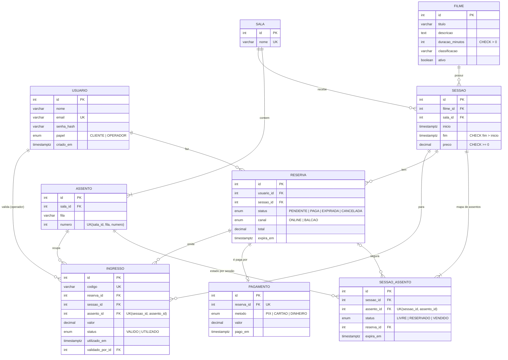

# Diagrama Entidade-Relacionamento

## Índices
`sessao(filme_id)`, `sessao(sala_id, inicio)`, `sessao(inicio)`, `sessao_assento(sessao_id, status)`, `sessao_assento(reserva_id)`, `reserva(usuario_id)`, `reserva(status, expira_em)` (usado pela procedure de expiração), `pagamento(pago_em)` (relatório de vendas), `ingresso(reserva_id)`, `filme(ativo)`.
